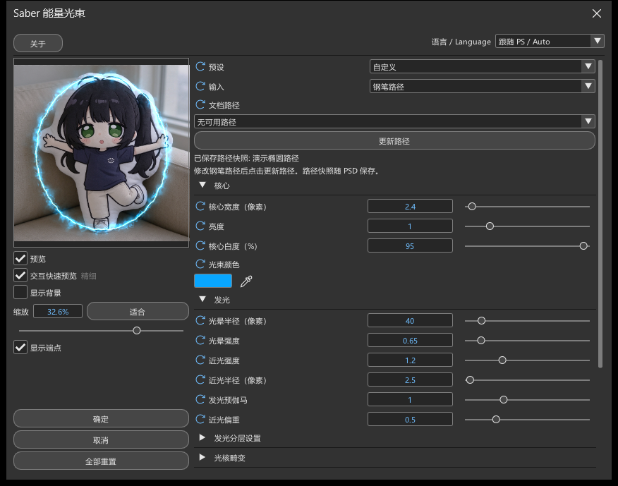

<p align="center"></p>

# AE-to-PS-Plugins

**23 free, open-source native Photoshop filters for glow, chromatic dispersion, energy, glass, procedural textures and distortion.**

English · [简体中文](README.md)

  

Independent implementations inspired by familiar After Effects effects. Work inside Photoshop with editable Smart Filters, Chinese/English controls, individual parameter resets and fast previews that refine after dragging stops.

**[Download Windows plugins](https://github.com/Three-LEI/AE-to-PS-Plugins/releases/download/v0.37/AE-to-PS-Plugins-0.37-Windows-x64.zip)** · [Release notes](https://github.com/Three-LEI/AE-to-PS-Plugins/releases/tag/v0.37) · **[All 23 parameter-window examples](docs/GALLERY.md)** · [Effect catalog](docs/EFFECTS.md)

## Parameter-window examples

Actual production parameter windows show the effect preview together with its configured controls. The cover is unchanged; see [all 23 windows](docs/GALLERY.md) for inputs and settings. The standalone capture tool uses the same production dialog and preview code without changing personal Photoshop documents.

### Deep Glow


### Saber energy



## Install

1. Download **Windows-x64.zip** above. “Code → Download ZIP” contains source code and requires compilation.
2. Quit Photoshop, back up previous plugins, and copy the required `.8bf` files from `Plug-ins` into Photoshop’s `Plug-ins` folder. Avoid duplicate copies across plugin folders.
3. Start Photoshop and use **Filter → ZaYu-AE Recreated Effects**. The menu name follows the host language.
4. For editable results, convert the layer to a **Smart Object** before applying a filter, then save the PSD. Each instance stores its own parameters.

Both Windows and Photoshop must be 64-bit. End users do not need After Effects, original third-party effects, the SDK or Python.

## Included effects

| Category | Filters |
| --- | --- |
| Light | Glow, Deep Glow, Starglow, Shine, Saber, Light Sweep |
| Color and lens | Tint, Chromatic Dispersion, Optics Compensation, Lens |
| Textures | Fractal Noise, Cell Pattern, Grid, Checkerboard, JPEG Damage |
| Distortion and surfaces | Displacement Map, Vector Blur, Turbulent Displace, Blobbylize, Glass, Kaleida |
| Edges and masks | Roughen Edges, Venetian Blinds |

Chromatic Dispersion includes spectral warp and prism defocus modes. Saber supports endpoints, paths, Alpha inputs and 16 original presets. Most filters support RGB8/16/32; Tint currently supports RGB8 only.

## What changed in 0.37

- Four new filters since 0.36-rc1: Starglow, Shine, Saber and Venetian Blinds.
- Adaptive preview resolution, improved Alpha sampling and source-preserving Blinds previews.
- Reused CPU worker threads and blur buffers; Glow/Deep Glow cache preparation when only composition parameters change.
- Deep Glow highlight refinement, more chromatic modes and Saber presets, larger action buttons and an overlay rendering indicator.

A 768×512 synthetic Deep Glow exposure test took approximately 351ms without the preparation cache and 19.5ms on a cache hit. Initial renders and radius changes still need preparation. Results depend on the input and system. [Measurement details](docs/PERFORMANCE.md)

## Compatibility and limits

- **PS2020 21.2.9 on the development Windows 11 PC:** 23 filters, 67 effect/depth combinations, undo and old PSD replay checked.
- **PS2026 27.7.0:** this package is installed; no new full native regression claim for this round.
- **Windows 7 + CC2018:** the user confirmed the earlier local 0.7 bundle works. Compatibility paths are retained; this version still needs external retesting.
- Other combinations are not comprehensively tested.

Effects use the **CPU**; the GPU draws the UI and displays previews. These are independent approximations, with no guarantee of pixel or random-seed equivalence to the original effects. Some effects cannot expand the canvas. Changes to external Glass/Blobbylize reference layers require reopening the filter. Previously unsaved parameters cannot be recovered retroactively.

[Validation scope](docs/VALIDATION.md) · [Parameter persistence](docs/PARAMETER_PERSISTENCE.md)

## Build and contribute

Development stays local until the maintainer explicitly requests a GitHub update. Publications are stable releases. [Release policy](docs/RELEASE_POLICY.md)


C++20, LLVM-MinGW, Win32, Dear ImGui and D3D11; 16 modules. CPU tests do not require Photoshop or its SDK:

```powershell
./build.ps1 -CoreOnly -Toolchain 'C:/Dev/llvm-mingw/bin'
```

A full build requires a separately obtained Photoshop C++ SDK. [Build guide](docs/BUILDING.md) · [Architecture](docs/ARCHITECTURE.md) · [Contributing](CONTRIBUTING.md)

[Report an issue or suggest an effect](https://github.com/Three-LEI/AE-to-PS-Plugins/issues/new/choose). If the plugins help your work, a Star makes updates easier to find.

## License

Project code is [MIT licensed](LICENSE). See [third-party notices](THIRD_PARTY.md) and the separate [demo asset notice](docs/assets/README.md). The photo and photo-containing demonstrations are excluded from the code’s MIT license. No Adobe SDK, proprietary effect binaries or Windows fonts are bundled. This project is not affiliated with or endorsed by Adobe or the original effect vendors.

by 淚泪泪 / Three-LEI
