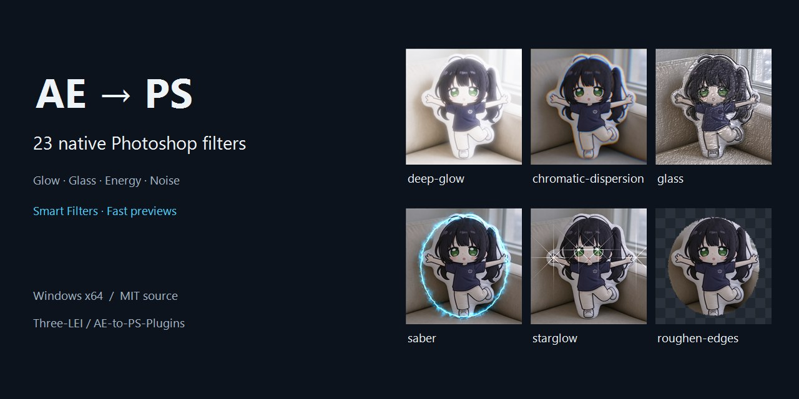
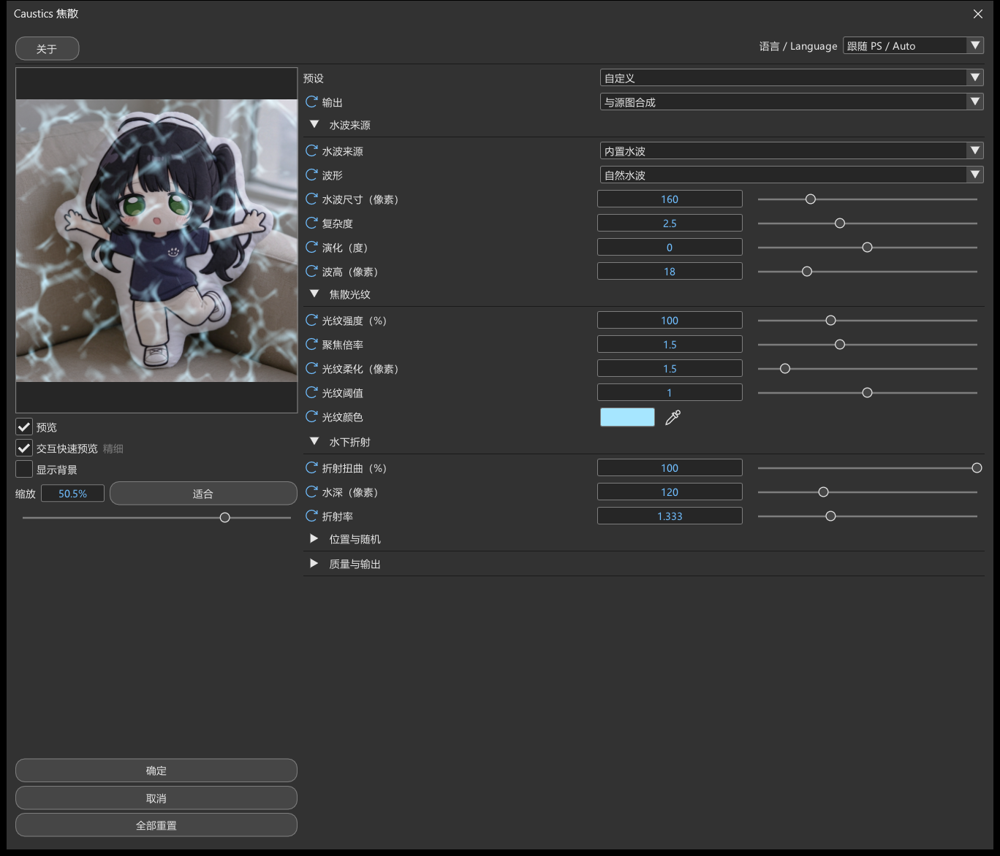
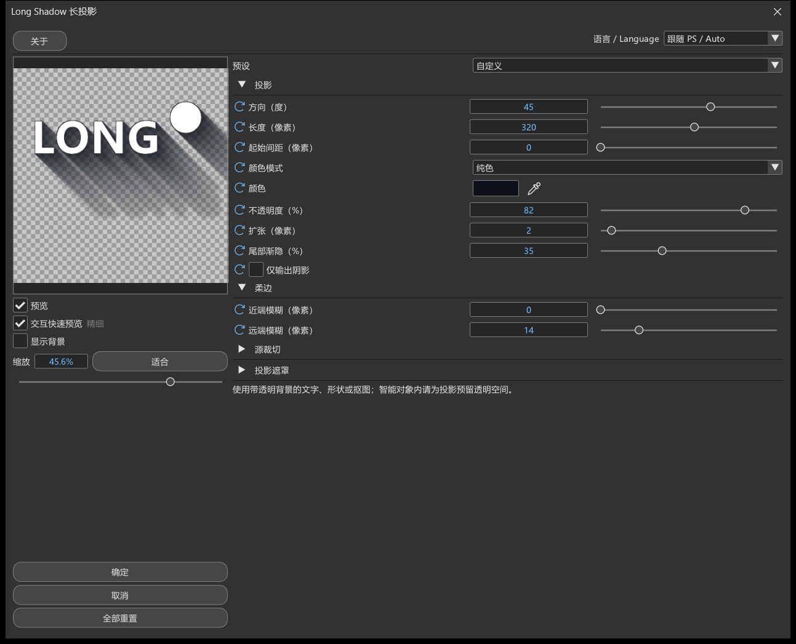
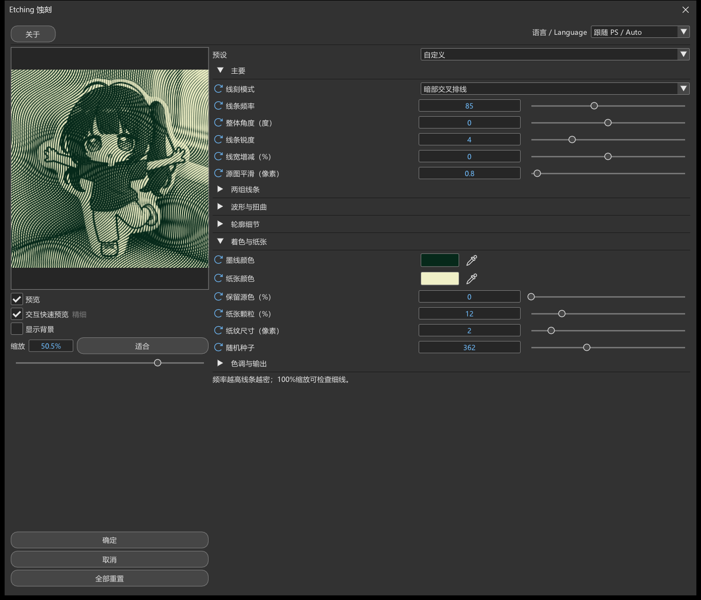
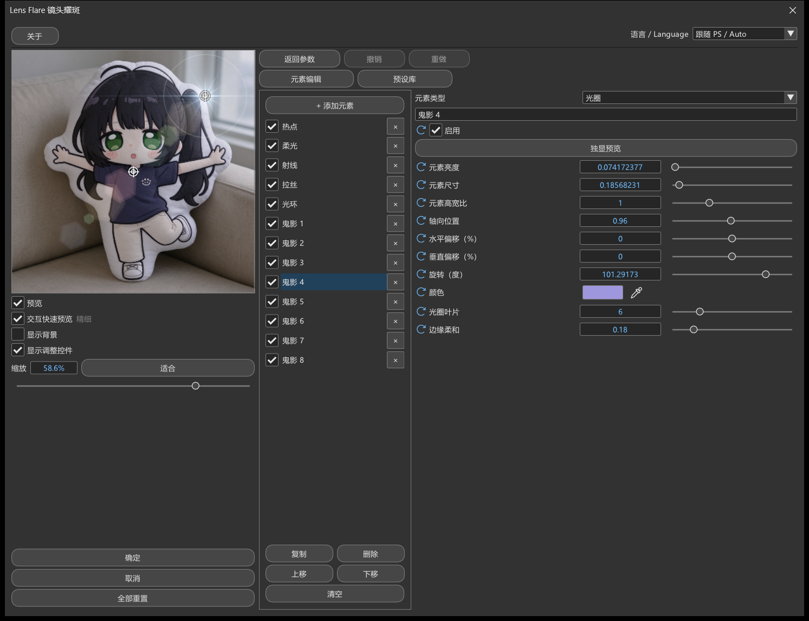

<p align="center"></p>

# AE-to-PS-Plugins

**Bring familiar After Effects effects to Photoshop: 31 free, open-source native Windows filters.**

English · [简体中文](README.md)

**Stable 0.39** adds **Caustics**, **Film Damage** and **Long Shadow** to the 28 filters in 0.38, and fixes filters on pixel layers that extend beyond the canvas as well as full-bounds reading of external reference layers.

  

Glow, dispersion, energy beams, glass, procedural textures and distortion inside Photoshop. Editable Smart Filters, Chinese/English controls, blue per-parameter resets, and previews that refine after dragging stops.

**[Download Windows plugins](https://github.com/Three-LEI/AE-to-PS-Plugins/releases/download/v0.39/AE-to-PS-Plugins-0.39-Windows-x64.zip)** · [Release notes](https://github.com/Three-LEI/AE-to-PS-Plugins/releases/tag/v0.39) · **[All 31 parameter-window examples](docs/GALLERY.md)** · [Effect catalog](docs/EFFECTS.md)

## Parameter-window examples

### Caustics



### Long Shadow



### Etching · Green Engraving



### Lens Flare Designer



Actual production parameter windows show the effect preview together with its configured controls. See [all 31 windows](docs/GALLERY.md) for inputs and settings. The cover is unchanged.

## Install

1. Download **Windows-x64.zip** above. “Code → Download ZIP” contains source code and requires compilation.
2. Quit Photoshop, back up previous plugins, and copy the required `.8bf` files from `Plug-ins` into Photoshop’s `Plug-ins` folder. Avoid duplicate copies across plugin folders.
3. Start Photoshop and use **Filter → ZaYu-AE Recreated Effects**. The menu name follows the host language.
4. For editable results, convert the layer to a **Smart Object** before applying a filter, then save the PSD. Each instance stores its own parameters.

Both Windows and Photoshop must be 64-bit. End users do not need After Effects, original third-party effects, the SDK or Python.

## Included effects

| Category | Filters |
| --- | --- |
| Light | Glow, Deep Glow, Starglow, Shine, Saber, Light Sweep |
| Color and lens | Tint, Chromatic Dispersion, Optics Compensation, Lens, Lens Flare Designer |
| Print and stylization | Halftone, ASCII Dither, Pixel Dither, Etching |
| Textures | Fractal Noise, Cell Pattern, Grid, Checkerboard, JPEG Damage |
| Distortion and surfaces | Displacement Map, Vector Blur, Turbulent Displace, Blobbylize, Glass, Kaleida |
| Water and light | Caustics |
| Film and mood | Film Damage |
| Shapes and shadows | Long Shadow |
| Edges and masks | Roughen Edges, Venetian Blinds |

Chromatic Dispersion includes spectral warp and prism defocus modes. Saber supports endpoints, paths, Alpha inputs and 16 original presets. Most filters support RGB8/16/32; Tint currently supports RGB8 only.

## What changed in 0.39

- **[Caustics 0.2](docs/CAUSTICS_LOCAL.md)**: caustic light and background refraction with independent controls, three built-in wave sets, current/external height maps, six presets and four outputs. New instances enable background refraction by default, with a “light-only” preset.
- **[Film Damage 0.5](docs/FILMDAMAGE_LOCAL.md)**: grain, dust, hair, stains, scratches, tone, vignette, light leak, defocus and static jitter; eight presets and 53 saved fields. Adds stain edge size.
- **[Long Shadow 0.3](docs/LONGSHADOW_LOCAL.md)**: alpha-driven directional shadows with source-color stretching, start gap, near/far blur, tail fade, source crop and rectangle/ellipse masks; five presets.
- **Off-canvas fix**: pixel layers extending beyond the canvas no longer error, clip or shift. Reads, writes, generator blending and previews use document coordinates; the selection `floatCoord` reset is fixed.
- **Full reference layers**: ten filters read external reference content by channel bounds, preserving document coordinates and Displacement Map placement. In-canvas output is unchanged.
- **Screenshots**: all 31 filters now have production parameter-window captures; the release also includes a 31-image lossless PNG archive.

[Full 0.39 release notes](docs/RELEASE_0.39.md). Install from Windows-x64.zip; source archives require compilation.

## Compatibility and limits

- **PS2020 21.2.9 on the development Windows 11 PC:** RGB8/16/32, Smart Filter instances, reopening, recalculation, undo and bilingual/DPI checks for the three additions; the shared coordinate fix passed 680 ordinary cases and 536 move/apply/move-back comparisons.
- **PS2026 27.7.0:** this package is installed; no new full native regression claim for this round.
- **Windows 7 + CC2018:** earlier bundles have user feedback; 0.39 keeps the legacy loading and DPI paths but still needs external retesting.
- Other combinations are not comprehensively tested.

Effects use the **CPU**; the GPU draws the UI and displays previews. These are independent approximations, with no guarantee of pixel or random-seed equivalence to the original effects. Some effects cannot expand the canvas. Changes to external Glass/Blobbylize reference layers require reopening the filter. Previously unsaved parameters cannot be recovered retroactively.

[Validation scope](docs/VALIDATION.md) · [Parameter persistence](docs/PARAMETER_PERSISTENCE.md)

## Build and contribute

Development stays local until the maintainer explicitly requests a GitHub update. Publications are stable releases. [Release policy](docs/RELEASE_POLICY.md)

C++20, LLVM-MinGW, Win32, Dear ImGui and D3D11; 24 modules. CPU tests do not require Photoshop or its SDK:

```powershell
./build.ps1 -CoreOnly -Toolchain 'C:/Dev/llvm-mingw/bin'
```

A full build requires a separately obtained Photoshop C++ SDK. [Build guide](docs/BUILDING.md) · [Architecture](docs/ARCHITECTURE.md) · [Contributing](CONTRIBUTING.md)

[Report an issue or suggest an effect](https://github.com/Three-LEI/AE-to-PS-Plugins/issues/new/choose). If the plugins help your work, a Star makes updates easier to find.

## License

Project code is [MIT licensed](LICENSE). See [third-party notices](THIRD_PARTY.md) and the separate [demo asset notice](docs/assets/README.md). The photo and photo-containing demonstrations are excluded from the code’s MIT license. No Adobe SDK, proprietary effect binaries or Windows fonts are bundled. This project is not affiliated with or endorsed by Adobe or the original effect vendors.

by 淚泪泪 / Three-LEI
