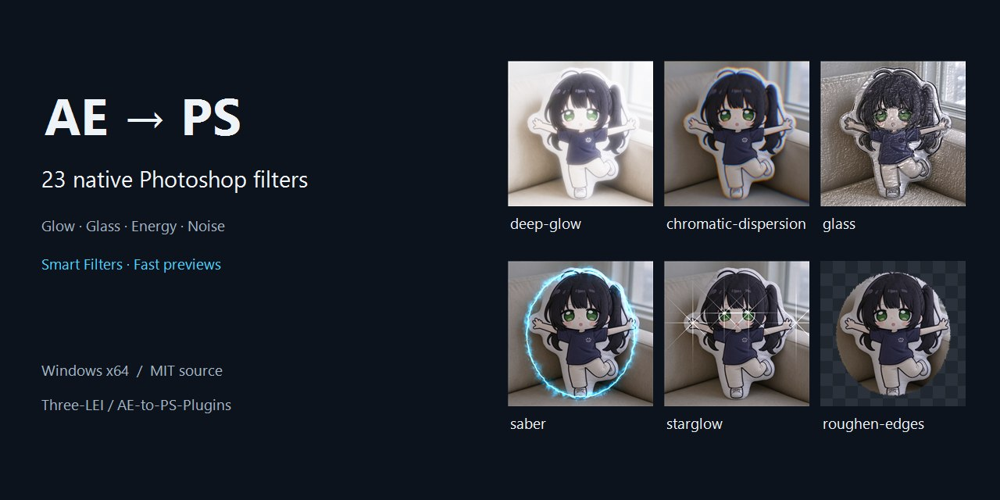
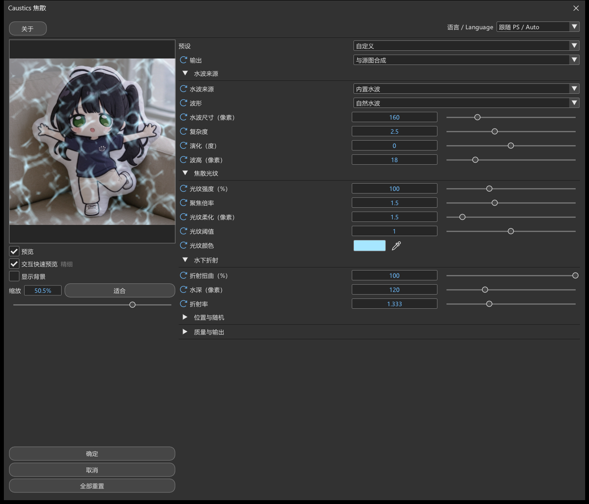
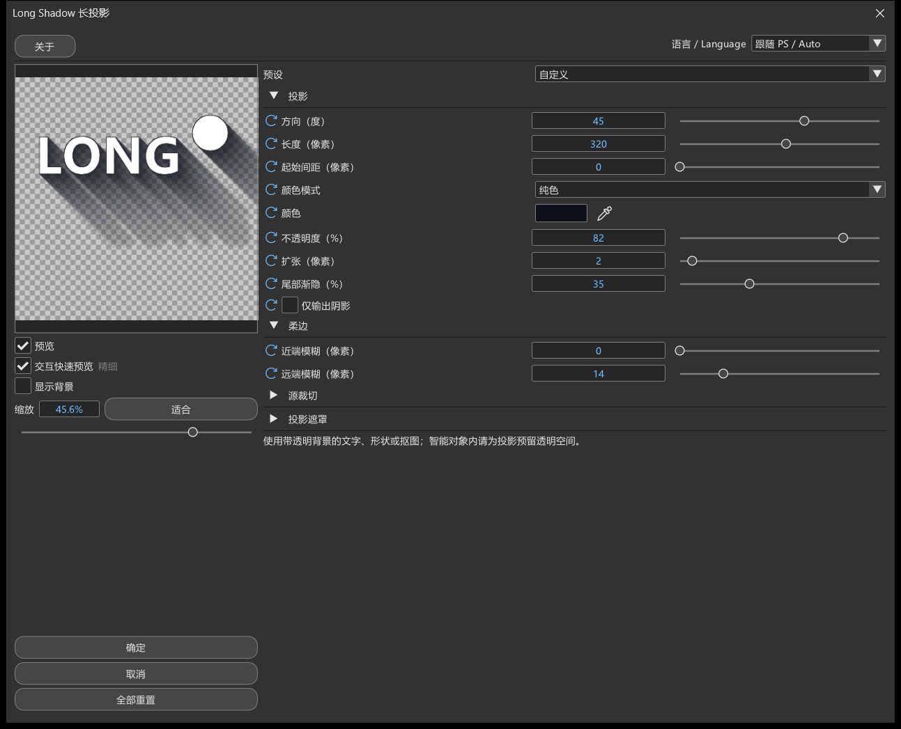
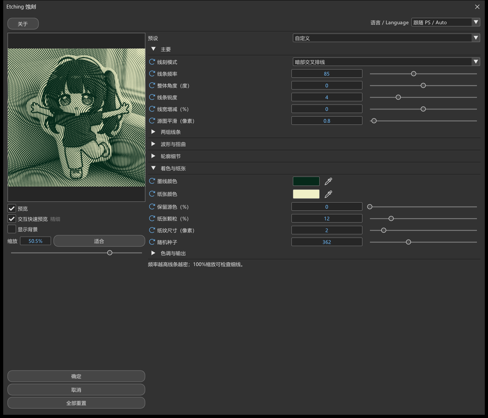
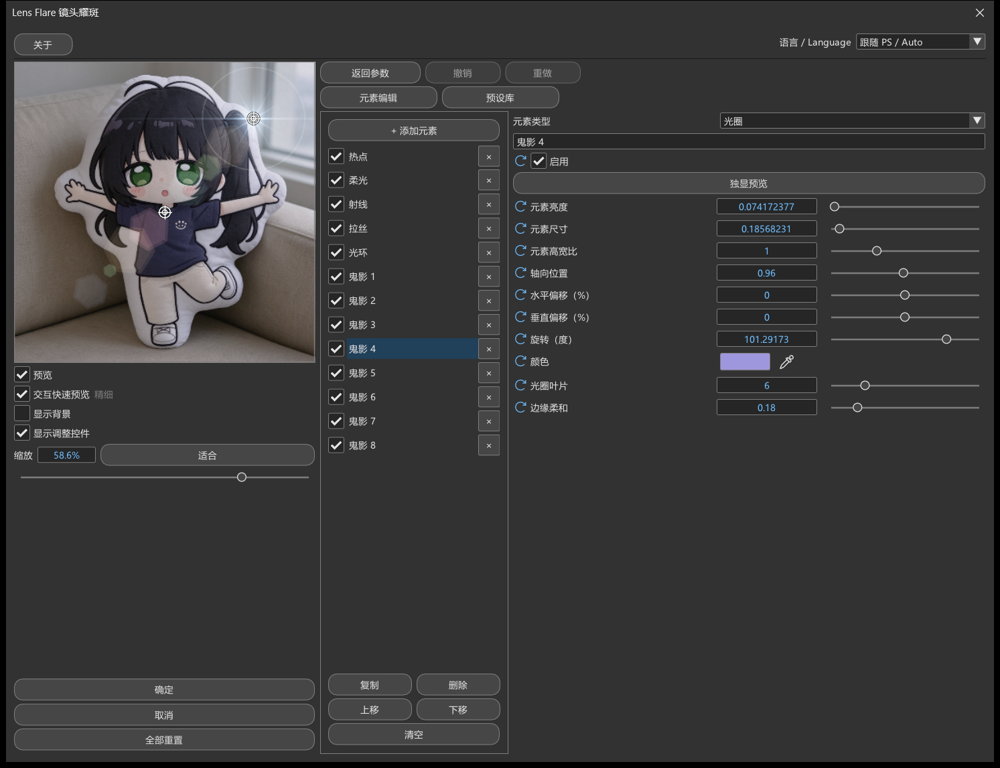

<p align="center"></p>

# AE-to-PS-Plugins

**把 After Effects 常见效果带到 Photoshop：31 款免费、开源的 Windows 原生滤镜。**

[English](README.en.md) · 简体中文

**0.39 正式版**在 0.38 的 28 款基础上新增 **Caustics 焦散**、**Film Damage 胶片损伤**和 **Long Shadow 长投影**，并修复普通图层超出画布时的报错／内容偏移，以及外部参考图层的完整范围读取。

  

发光、色散、能量光束、玻璃、程序纹理与画面变形，都能在 Photoshop 内完成。支持智能滤镜参数保存、中英文界面、蓝色单项重置，以及拖动时快速预览、停止后自动补全质量。

**[下载 Windows 插件包](https://github.com/Three-LEI/AE-to-PS-Plugins/releases/download/v0.39/AE-to-PS-Plugins-0.39-Windows-x64.zip)** · [本次更新](https://github.com/Three-LEI/AE-to-PS-Plugins/releases/tag/v0.39) · **[31 款参数窗口图集](docs/GALLERY.md)** · [完整清单](docs/EFFECTS.md)

## 参数窗口示例

### Caustics 焦散



### Long Shadow 长投影



### Etching 蚀刻 · 绿钞雕版



### Lens Flare · 耀斑设计器



以上均为插件实际生产参数窗口，展示效果预览和当前调整数值。全部 31 款窗口、输入条件与参数见[完整图集](docs/GALLERY.md)。首页分享封面保持不变。

## 安装与使用

1. 下载上方 **Windows-x64.zip 插件包**。“Code → Download ZIP” 是源码，需要自行编译。
2. 退出 Photoshop，备份旧版同名插件，将包内 `Plug-ins` 中所需的 `.8bf` 放入 Photoshop 的 `Plug-ins` 文件夹。避免在多个目录保留重复副本。
3. 启动 Photoshop，在 **滤镜 → ZaYu-AE 效果复刻** 中使用。
4. 需要反复修改时，先把目标层转换为**智能对象**，再添加效果并保存 PSD；重新打开后可继续编辑各实例参数。

普通使用无需 AE、原版效果插件、SDK 或 Python。Windows 与 Photoshop 均需为 64 位。

## 包含哪些效果

| 类别 | 效果 |
| --- | --- |
| 发光与光线 | Glow 发光、Deep Glow 深度发光、Starglow 星芒、Shine 放射光束、Saber 能量光束、Light Sweep 扫光 |
| 色彩与镜头 | Tint 色调、Chromatic Dispersion 色差色散、Optics Compensation 光学补偿、Lens 镜头、Lens Flare 镜头耀斑／设计器 |
| 印刷与风格化 | Halftone 网点印刷、ASCII Dither 字符抖动、Dither 像素抖动、Etching 蚀刻 |
| 纹理与图案 | Fractal Noise 分形杂色、Cell Pattern 单元格图案、Grid 网格、Checkerboard 棋盘、JPEG Damage JPEG 损坏 |
| 变形与表面 | Displacement Map 置换图、Vector Blur 矢量模糊、Turbulent Displace 湍流置换、Blobbylize 胶状化、Glass 玻璃、Kaleida 万花筒 |
| 光影与水效 | Caustics 焦散 |
| 胶片与风格 | Film Damage 胶片损伤 |
| 形状与阴影 | Long Shadow 长投影 |
| 边缘与遮罩 | Roughen Edges 毛边、Venetian Blinds 百叶窗 |

色差色散包含光谱扭曲与棱镜散焦模式；Saber 支持两点、路径、Alpha 输入及 16 款自有预设。多数效果支持 RGB8／16／32，Tint 当前仅 RGB8。[参数与模块列表](docs/EFFECTS.md)

## 本次更新：0.39 正式版

- **[Caustics 焦散 0.2](docs/CAUSTICS_LOCAL.md)**：水波光纹与背景折射独立调节，三种内置水波、当前／外部高度图、六套预设、四种输出；新实例默认开启背景折射，并加入“仅叠加水光”。
- **[Film Damage 胶片损伤 0.5](docs/FILMDAMAGE_LOCAL.md)**：颗粒、灰尘、毛发、污渍、划痕、色调、暗角、漏光、失焦与固定状态抖动，八套预设、53 个保存字段；新增污渍边缘尺寸。
- **[Long Shadow 长投影 0.3](docs/LONGSHADOW_LOCAL.md)**：按 Alpha 生成定向长影，支持源色拉伸、起始间距、近远模糊、尾部渐隐、源裁切与矩形／椭圆遮罩；五套预设。
- **画布外内容修复**：普通像素层超出画布时不再报错、丢失或位移，读写与预览统一到文档坐标，选区下的坐标归零问题一并修正。
- **完整参考图层**：10 款滤镜按宿主通道边界读取画布外参考内容，保留原文档坐标与置换贴图设置；画布内输出保持不变。
- **截图**：31 款全部更新为实际生产参数窗口截图，Release 另附 31 张无损 PNG。

[完整 0.39 更新说明](docs/RELEASE_0.39.md)。程序安装请选择 Windows-x64.zip；source.zip 及“Code → Download ZIP”是开发源码。

## 兼容与限制

| 环境 | 已知情况 |
| --- | --- |
| PS2020 21.2.9，本机 Windows 11 | 三款新增效果的 RGB8／16／32、智能滤镜实例、重开／重算／撤销及中英文／DPI；公共坐标修复通过 680 个普通用例与 536 组移动对照 |
| PS2026 27.7.0 | 已安装本次包；本轮未增加完整实机回归声明 |
| Win7＋CC2018 | 此前整包已有用户反馈可运行；0.39 保留传统加载与旧 DPI 路径，仍需外机复测 |
| 其他 Windows／PS 版本 | 未覆盖所有组合，请反馈具体系统、PS 版本与位深 |

这是依据公开行为独立实现的效果集合，与原版不保证逐像素一致；随机纹理也不保证同一种子形态相同。效果生成使用 **CPU**，GPU 用于界面与预览显示。部分效果不能自动扩展 Photoshop 画布。

Glass／Blobbylize 的外部参考层修改后，需要重新进入效果确认更新。Lens Flare 继续使用版本 2 元素快照，早期未发布试验文件不承诺回读。此前没有保存的参数无法追溯恢复。[完整验证范围](docs/VALIDATION.md) · [智能滤镜参数保存](docs/PARAMETER_PERSISTENCE.md)

## 开发与贡献

默认只在本机开发和测试；只有维护者明确要求更新到 GitHub 时才发布正式版。[开发与发布约定](docs/RELEASE_POLICY.md)

实现采用 C++20、LLVM-MinGW、Win32、Dear ImGui 与 D3D11，共 24 个模块。纯 CPU 核心测试无需 Photoshop 或 SDK：

```powershell
./build.ps1 -CoreOnly -Toolchain 'C:/Dev/llvm-mingw/bin'
```

完整构建需要开发者单独获取 Photoshop C++ SDK。[构建说明](docs/BUILDING.md) · [项目结构](docs/ARCHITECTURE.md) · [参与贡献](CONTRIBUTING.md)

欢迎[反馈问题和建议](https://github.com/Three-LEI/AE-to-PS-Plugins/issues/new/choose)，并提供有权公开的最小案例。如果这些插件对你的创作有帮助，欢迎 Star，方便以后找到更新。

## 许可

自有代码采用 [MIT](LICENSE)，第三方依赖见 [THIRD_PARTY.md](THIRD_PARTY.md)。[演示照片与含照片的展示图](docs/assets/README.md)不属于代码 MIT 授权范围。仓库不提供 Adobe SDK、原版效果二进制或 Windows 字体。

本项目与 Adobe、原版效果及相关厂商无隶属或背书关系。

by：淚泪泪 / Three-LEI
