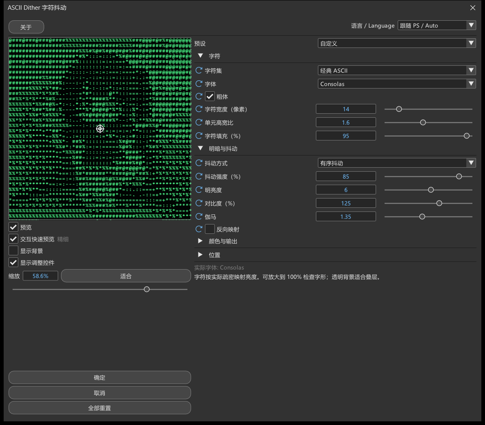

# ASCII Dither 字符抖动（0.38收录）

**已收录0.38正式版。** [下载安装包](https://github.com/Three-LEI/AE-to-PS-Plugins/releases/download/v0.39/AE-to-PS-Plugins-0.39-Windows-x64.zip)；本文件名沿用开发阶段命名。`evidence`／`dist`路径为维护者本地历史记录，公开验证见[VALIDATION.md](VALIDATION.md)。

最初作为第 25 款原生滤镜，沿用现有滤镜分组。已随0.38正式版分发。参数与算法范围见 [ascii/README.md](../ascii/README.md)。

示例使用维护者提供的照片，经典字符集、Consolas 粗体、字符宽 14px、高宽比 1.6、填充 95%、有序抖动 85%、明亮度 6、对比度 125%、伽马 1.35、绿色字符。截图来自生产参数窗口与精细预览代码；字段见 [gallery-parameters.json](gallery-parameters.json)，图片权利范围见 [素材说明](assets/README.md)。

## 试用

本机 PS2020／PS2026 已新增 `ZaYuASCIIDither.8bf`。从“滤镜 → ZaYu-风格化 → ASCII Dither 字符抖动”打开，可先试绿色终端、彩色字符和二进制屏幕。检查字体轮廓时放大到 100%；需要保存可编辑参数时使用智能对象。

从[0.38安装包](https://github.com/Three-LEI/AE-to-PS-Plugins/releases/download/v0.39/AE-to-PS-Plugins-0.39-Windows-x64.zip)安装`ZaYuASCIIDither.8bf`。

## 验证范围

核心检查覆盖字形面积积分、实际系统字体／字重／字符集、字形密度排序、非均匀级阶的有序与误差扩散、HDR 色相、透明度和混合、坐标、极小／非整数网格、取消及 GDI 对象回收。六组完整浮点串行／并行输出一致；中英文／DPI 生产窗口通过拖动、精细补全、单项重置与取消检查。共享参数保存层包含新模块的 15,774 项检查通过。

核心 33,433 项检查、真实 DLL 4,739,507 项适配检查通过。PS2020 21.2.9 的 18 个普通效果／位深组合、36 个智能滤镜实例、48 项图像核对通过，覆盖保存 PSD、完全退出后在新进程重开、强制重算、撤销和源内容变化／恢复。干净导出的源码完成新模块核心构建。

兼容依赖与最终包摘要见本地 `evidence/ascii-v01/qa.json`。实际 PE 为 x64、OS／Subsystem 6.0，传统 PiPL/aete 共 26 个术语（24 个字段加版本与身份）。新增依赖为经典 GDI 字体函数和 CRT 字符串比较，保留旧系统公共路径；Win7／CC2018 仍需外机复测。PS2026 本轮仅安装。字形取决于系统字体版本，不承诺不同电脑逐像素相同。
