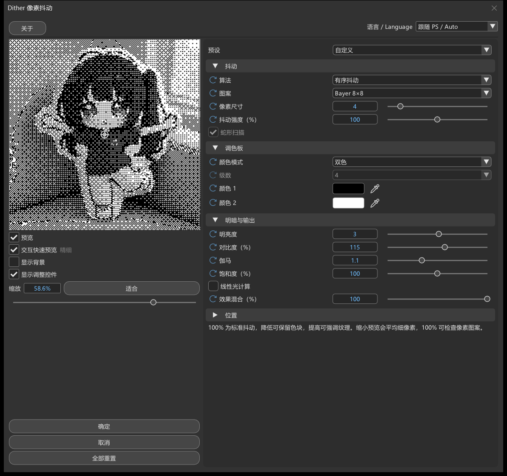

# Dither 像素抖动（0.38收录）

**已收录0.38正式版。** [下载安装包](https://github.com/Three-LEI/AE-to-PS-Plugins/releases/download/v0.39/AE-to-PS-Plugins-0.39-Windows-x64.zip)；本文件名沿用开发阶段命名。`evidence`／`dist`路径为维护者本地历史记录，公开验证见[VALIDATION.md](VALIDATION.md)。

根据维护者提供的黑白渐变、像素画限色和规则网纹示例新增独立滤镜。Halftone 网点印刷与 ASCII Dither 字符抖动继续保留原名称和功能；新增滤镜内部整合不同抖动与调色板模式。已收录0.38正式版。

使用维护者提供的演示照片，Bayer 8×8、双色黑白、像素尺寸 4、强度 100%、明亮度 3、对比度 115%、伽马 1.1。截图来自实际生产窗口及精细预览；完整参数见 [gallery-parameters.json](gallery-parameters.json)。原参考图未复制进公开素材，演示照片权利范围保持[原说明](assets/README.md)。

## 试用

本机 PS2020／PS2026 新增 `ZaYuDither.8bf`。在“滤镜 → ZaYu-AE 效果复刻 → Dither 像素抖动”打开。可先试黑白像素、蓝色月光和图形竖线；模拟较粗像素画时增大像素尺寸。

从[0.38安装包](https://github.com/Three-LEI/AE-to-PS-Plugins/releases/download/v0.39/AE-to-PS-Plugins-0.39-Windows-x64.zip)安装`ZaYuDither.8bf`。使用智能对象可保存每个实例的全部 27 个字段。

## 验证范围

核心检查覆盖九种阈值图案、调色板成员约束、算法／颜色模式组合、平均明暗、原生图案面积与缩图一致性、透明度、坐标、非整数／极小网格和取消。六组完整浮点串行／并行输出一致；中英文生产窗口验证连续拖动、精细补全、重置与取消。共享保存层含新模块的 16,407 项检查通过。

核心 231,424 项、真实 DLL 4,739,507 项检查通过。PS2020 21.2.9 的 18 个普通效果／位深组合、36 个智能滤镜实例、48 项图像核对通过，包含退出后在新进程重开、强制重算、撤销及源内容改变／恢复。干净导出源码完成新模块核心构建。

兼容依赖与最终包摘要见本地 `evidence/dither-v01/qa.json`。PE 为 x64、OS／Subsystem 6.0，传统 PiPL/aete 共 29 个术语（27 个字段加版本与身份），相对现有 Halftone 无新增导入函数。PS2026 本轮仅安装；保留旧系统公共路径，Win7／CC2018 仍需外机复测。
