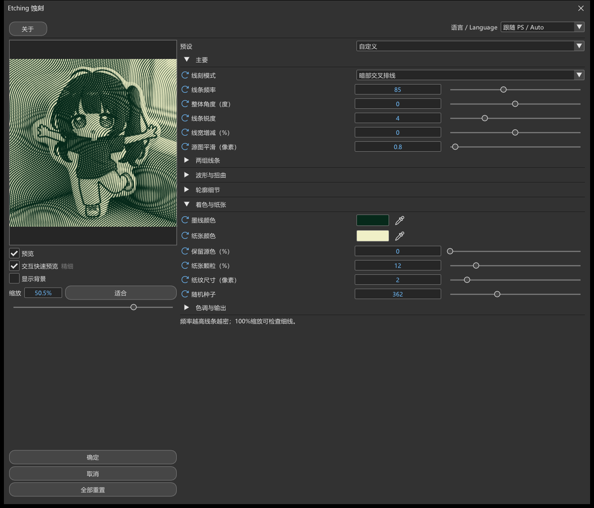

# Etching 蚀刻（0.38收录）

**已收录0.38正式版。** [下载安装包](https://github.com/Three-LEI/AE-to-PS-Plugins/releases/download/v0.38/AE-to-PS-Plugins-0.38-Windows-x64.zip)；本文件名沿用开发阶段命名。`evidence`／`dist`路径为维护者本地历史记录，公开验证见[VALIDATION.md](VALIDATION.md)。

将照片转为两组粗细随明暗变化的曲线，叠加轮廓细节，适合货币雕版、复古印刷和肖像版画。参考 [S_Etching公开参数](https://borisfx.com/documentation/sapphire/ae/etching/)，独立实现。

## 使用

在“滤镜 → ZaYu-AE 效果复刻 → Etching 蚀刻”打开。建议从“绿钞雕版”或“经典蚀刻”预设开始，再调线条频率、波形与扭曲、源平滑和边缘细节。

- 频率越高，线条越密；两组线条可分别调频率倍率与相对角度，倍率0关闭该组。
- 双线蚀刻使用两组线条表现明暗；单线版画保留一组；暗部交叉排线让第二组主要进入阴影。
- 波形控制弯曲起伏，亮度扭曲让线条随源图明暗发生形变。平滑可减少碎纹，保留整体形体。
- 边缘参数补充轮廓；想要更柔和的印刷质感，可降低边缘强度、提高源平滑。
- 墨色、纸色、保留源色和纸纹用于设置印刷配色。另有复古棕墨、单线肖像、交叉排线和蓝墨版画等预设，共六个。
- “仅墨线（透明）”移除纸色，适合叠在其他底图上。建议用普通透明图层或智能对象；PS选区或蒙版可控制作用范围。

拖动使用公共自适应预览，停止后自动精细计算。线网保持原文档坐标，缩小显示时按覆盖率及面积平均减少细线摩尔纹；100%缩放可检查线条。最终输出完整计算，不改变用户参数。

## 参数保存和安装

应用在智能对象上，37个字段通过公共保存机制随PSD留存，包括模式、两组线条、形变、轮廓、颜色、纸纹、种子和输出控制。CPU计算，支持RGB8／16／32、中英文、蓝色单项及全部重置。

[0.38安装包](https://github.com/Three-LEI/AE-to-PS-Plugins/releases/download/v0.38/AE-to-PS-Plugins-0.38-Windows-x64.zip)中包含 `ZaYuEtching.8bf`。本机PS2020／2026已安装；PS2026本轮仅安装，Win7／CC2018保留旧系统加载与界面路径，仍需外机复测。最终验证摘要见本地 `evidence/etching-v01/qa.json`。

这是静态二维蚀刻重建，不包含原版程序、预设资源、Mocha或AE不透明度处理模式，也不声明逐像素复现。0.38正式版共28款／21模块。
