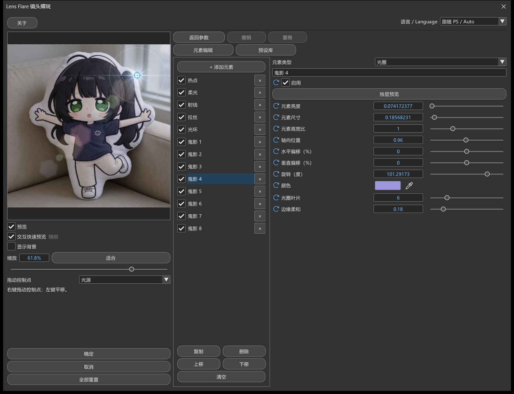

# Lens Flare 耀斑设计器（0.38收录）

**已收录0.38正式版。** [下载安装包](https://github.com/Three-LEI/AE-to-PS-Plugins/releases/download/v0.38/AE-to-PS-Plugins-0.38-Windows-x64.zip)；本文件名沿用开发阶段命名。`evidence`／`dist`路径为维护者本地历史记录，公开验证见[VALIDATION.md](VALIDATION.md)。

在现有 Lens Flare 镜头耀斑中，继续完善参考 Optical Flares 的独立元素组合工作流。现随0.38正式版分发，整包共28款／21模块。

## 添加与管理

打开 Lens Flare，点击“耀斑设计器”，再点“+ 添加元素”。选择可视卡片即可加入；按住 Shift 点击可以连续添加。新增或复制后，列表自动滚动到选中项。

- 十二类元素：热点、柔光、射线、拉丝、光环、多边形光圈、光弧、多重光圈、星耀、闪烁光点、线环、光谱色带。单个设计最多64个元素。
- 每行右侧“×”直接删除；Ctrl+D复制选中元素，Delete删除。正在编辑名称或数值、选色或操作弹出面板时暂停这些快捷键。
- 拖动列表条目可排序，仍保留上移／下移按钮。当前项以蓝色突出显示；编辑支持最多48步撤销／重做。
- 自动名称跟随中英文界面，包括鬼影编号和副本名称。输入自己的名称后按原样保留，点击“自动名称”可恢复随语言切换。
- 右侧可切换元素类型，并调整位置、形状、颜色和类型参数。独显只用于预览，单项重置继续保留。

轴向位置0为光源，1为光学中心，2为光源经过光学中心后的镜像位置；二维偏移按画面短边百分比计算。返回参数页可继续调整整体亮度、尺寸、色彩、遮挡和输出。光学元素以发光相加组合，排序主要用于整理。

## 预设库

十二个自有预设，新增光弧晨曦、电影散景、星幕和光谱之翼，用于展示新增元素。缩略图从第一阶段的32×20提高到640×400，使用实际渲染，后台逐张生成并缓存；悬停可放大查看。完成后切换页面不会重新生成或反复上传图片。

支持保存新预设、载入、导入与导出 `.aepsflare`。同名本地保存自动编号，默认位于 `%APPDATA%/AE-to-PS-Plugins/LensFlare/Presets`。载入外观保留当前文档的光源、光学中心、遮挡层和输出方式。预设使用自有格式，不读取AK原版预设或资源。

## 保存与安装

参数及元素名称、类型、顺序、可见性随智能滤镜保存到PSD，重开无需依赖本机预设文件。0.38起采用版本2元素快照作为发布接口；更早的未发布试验PSD和预设不承诺回读。旧试验文件不会被主动修改。

[0.38安装包](https://github.com/Three-LEI/AE-to-PS-Plugins/releases/download/v0.38/AE-to-PS-Plugins-0.38-Windows-x64.zip)中包含 `ZaYuLensFlare.8bf`，关闭PS后替换同名文件再启动。本机PS2020／2026已安装（2026仅安装）。PS2020 21.2.9验证当前格式的RGB8／16／32普通输出、PSD保存、新进程重开与重算；Win7／CC2018保留旧系统路径，仍需外机复测。记录见本地 `evidence/flare-v03/qa.json`。

外部遮挡层修改后仍需手动重新进入刷新；完整输出仍使用CPU和公共自适应预览。当前实现包含独立二维元素和预设管理；纹理对象、渐变曲线、AE三维灯光与跟踪可另行扩展。

该设计器开发阶段仅修改Lens Flare；本次整包更新见[0.38发行说明](RELEASE_0.38.md)。
