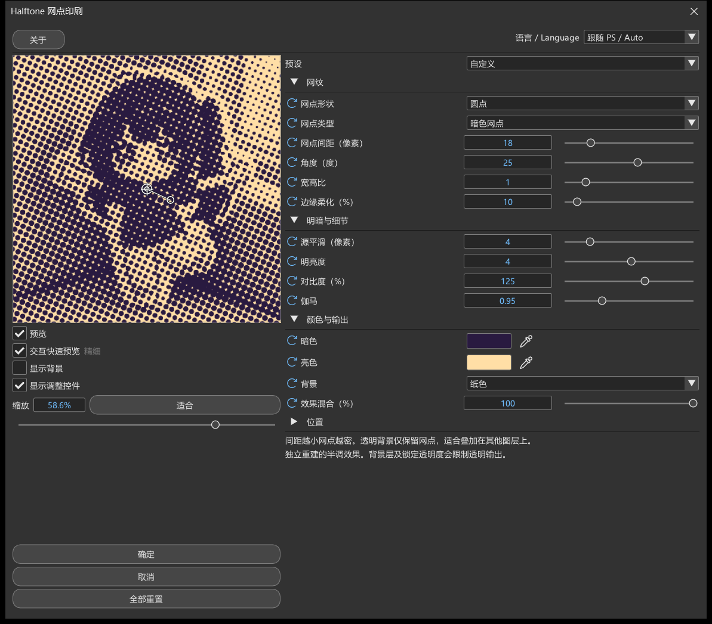

# Halftone 网点印刷（0.38收录）

**已收录0.38正式版。** [下载安装包](https://github.com/Three-LEI/AE-to-PS-Plugins/releases/download/v0.39/AE-to-PS-Plugins-0.39-Windows-x64.zip)；本文件名沿用开发阶段命名。`evidence`／`dist`路径为维护者本地历史记录，公开验证见[VALIDATION.md](VALIDATION.md)。

最初作为第 24 款原生滤镜，沿用原有滤镜分组。现已随0.38正式版分发。模块参数、算法边界和构建见 [halftone/README.md](../halftone/README.md)。

这张示例使用维护者提供的演示照片，间距 18px、25°、源平滑 4px、明亮度 4、对比度 125%、伽马 0.95、深紫／浅黄双色。图集保存完整的生产窗口和精细预览，具体字段见 [gallery-parameters.json](gallery-parameters.json)。演示图片权利范围见 [素材说明](assets/README.md)。

## 试用

本机 PS2020／PS2026 安装后，在“滤镜 → ZaYu-风格化 → Halftone 网点印刷”中打开。先试“复古双色”“漫画细网”或“斜线印刷”；制作透明网点叠层时选“透明油墨”。需要编辑参数时使用智能对象。

从[0.38安装包](https://github.com/Three-LEI/AE-to-PS-Plugins/releases/download/v0.39/AE-to-PS-Plugins-0.39-Windows-x64.zip)安装`ZaYuHalftone.8bf`。

## 验证范围

核心 982,256 项检查、真实 DLL 4,739,507 项适配检查、六组完整浮点串并行对照及两组中英文／DPI 生产窗口检查通过。共享参数保存层包含新模块的 15,201 项检查通过，原有字段登记保持，仅补齐此前百叶窗缺失的测试身份值；旧插件程序未改。干净源码导出和新模块核心构建通过。

PS2020 21.2.9：18 个普通效果／位深组合、36 个智能滤镜实例、48 项图像核对通过，覆盖撤销、保存 PSD、完全退出后在新进程重开、强制重算和源内容修改／恢复。完整结果见本地 `evidence/halftone-v01/qa.json`。

同一合成输入的纯 CPU 中位数：512×384 默认圆点约 8.9ms、线条约 6.7ms；1024×768 约 39.5／28.7ms。不含 Photoshop 读取与显示，不能直接推算实机帧率。

PS2026 本轮仅安装；保留 Win7／PS2018 的公共注册、DPI 和描述符路径，仍需外机复测。实际 PE 为 x64、OS／Subsystem 6.0，传统 PiPL/aete 共 22 个术语（20 个参数加版本与身份）；相对现有百叶窗没有增加 Win32 导入函数，新增 CRT 数学函数 `acos` 已记录。
