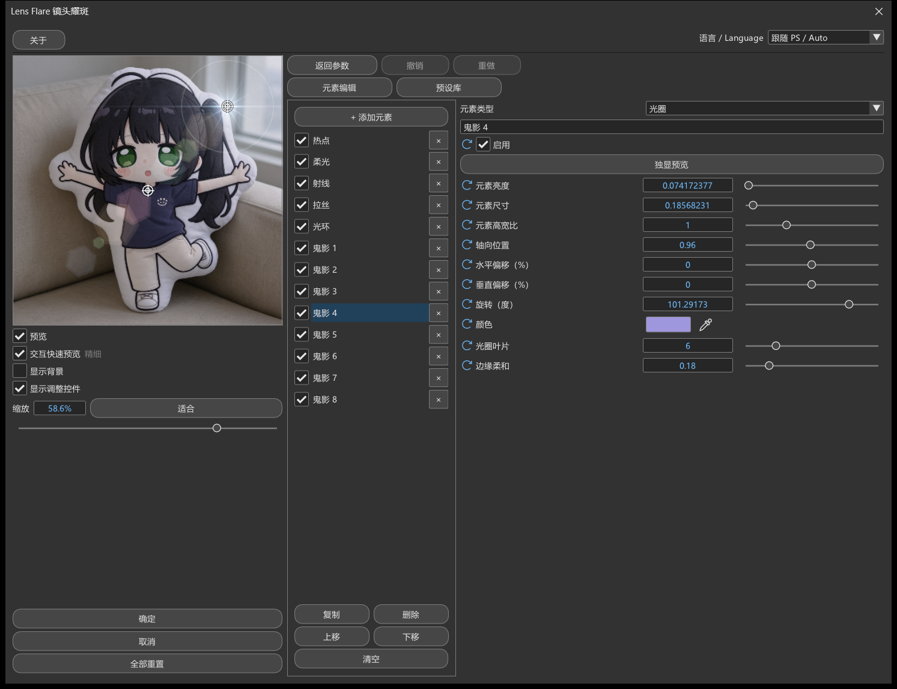

# Lens Flare 镜头耀斑（本地 0.1 阶段记录）

当前正式发行功能见[耀斑设计器说明](FLARE_DESIGNER_LOCAL.md)。以下仅为未发布0.1阶段的历史记录，不代表0.38当前接口或兼容承诺。

用户指定参考 [S_LensFlare](https://borisfx.com/documentation/sapphire/ae/lensflare/)，新增适合 Photoshop 静态合成的二维版本。当时正式版为0.37，本地工作区为27款／20模块，尚未公开该试验阶段。

截图使用既有授权演示照片，光源 (610,145)、光学中心 (384,384)、亮度 1.15、整体尺寸 100%、热点尺寸 0.9、鬼影亮度 0.8、鬼影尺寸 1.1、光环亮度 0.45；其他参数与电影蓝光预设一致。来自生产窗口及精细预览，完整数值见 [示例参数](gallery-parameters.json)，照片许可范围见[素材说明](assets/README.md)。

## 试用

本机 PS2020／PS2026 新增 `ZaYuLensFlare.8bf`。重启 PS 后从“滤镜 → ZaYu-生成”打开；先试电影蓝光、暖阳、宽银幕蓝和复古镜头。用左键分别拖动预览中的光源和光学中心手柄，也可在参数框输入画面外坐标。

仅耀斑（透明）模式方便叠加到其他图层，建议使用普通层或智能对象，并预留画布边距。使用智能对象可保存每个实例的全部 54 个字段。外部遮挡层的名字保留，内容变化需要手动重新进入效果刷新。

独立包 `dist/AEPS-Lens-Flare-local-0.1.zip` 只含一个滤镜；退出 PS 后安装。回退时移出该文件，原 26 款无需替换。参数与范围详见 [模块说明](../flare/README.md)。

## 验证范围

核心覆盖八个预设、各组件独立开关、透明发光与黑底相加的光能一致性、HDR、原生坐标平移、Alpha／亮度遮挡、软遮挡、低分辨率几何、细射线能量、极小输入和取消；八组完整浮点串并行结果一致。真实 DLL 检查 RGB8／PS16／HDR32、旧／新坐标、锁定／平坦 Alpha、外部遮挡、选区／行填充和错误清理。

两组中英文／DPI 生产窗口检查连续拖动、停止补全、右键拖动光源、单项／全部重置、取消和布局。共享保存层含新模块的 17,974 项检查通过。

PS2020 21.2.9 的 18 个普通位深组合、36 个智能滤镜实例、49 项重开／强制重算／撤销／源变化／中文遮挡像素检查及 18 项独立核心输出对照通过。最终检查统计和摘要记录于本地 `evidence/flare-v01/qa.json`。

PE 为 x64、OS／Subsystem 6.0，传统 PiPL/aete 共 56 个术语（54 字段加版本／身份），相对现有 Halftone 无新增导入函数。PS2026 本轮仅安装，Win7／CC2018 仍需外机复测；保留既有公共兼容路径。
