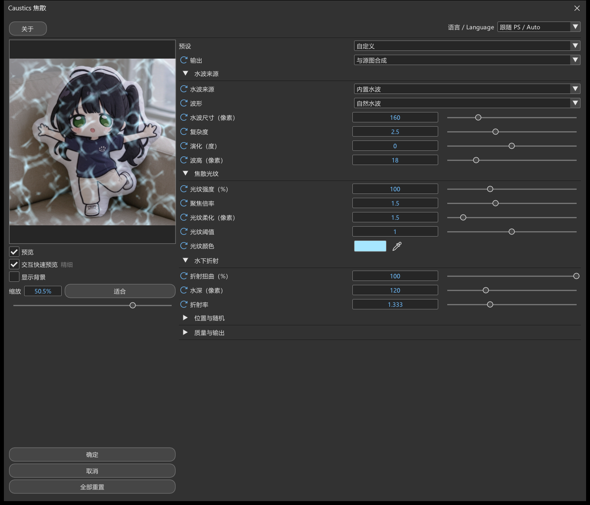
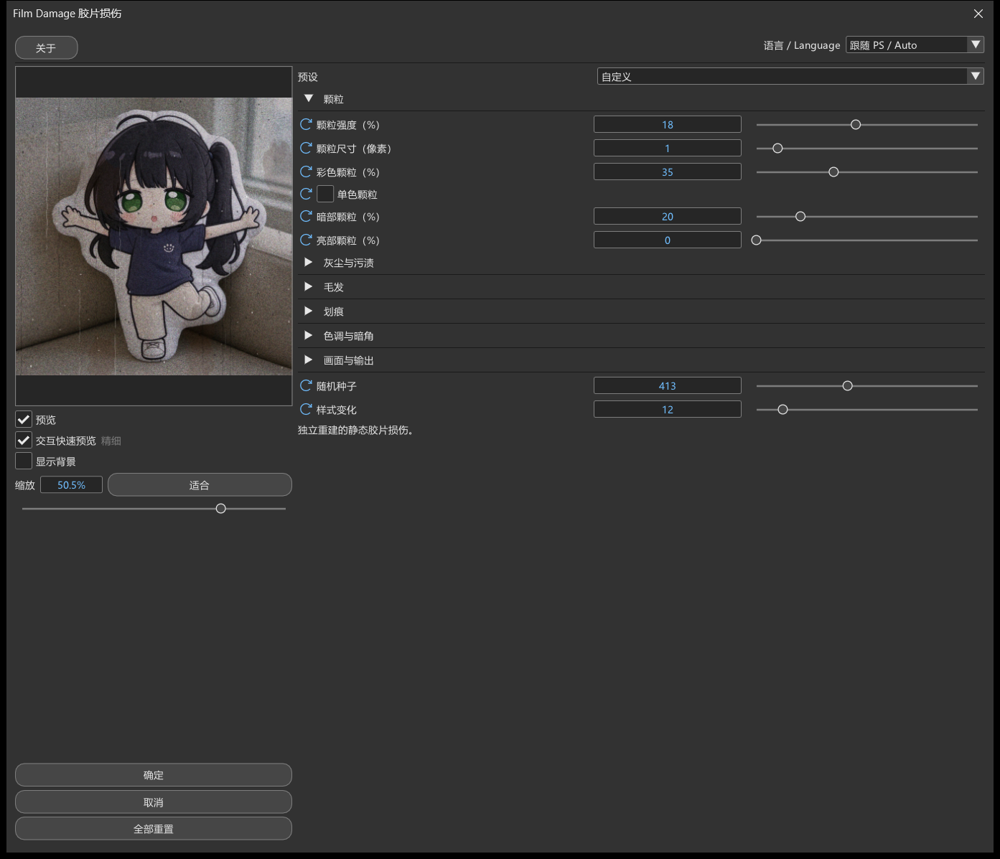
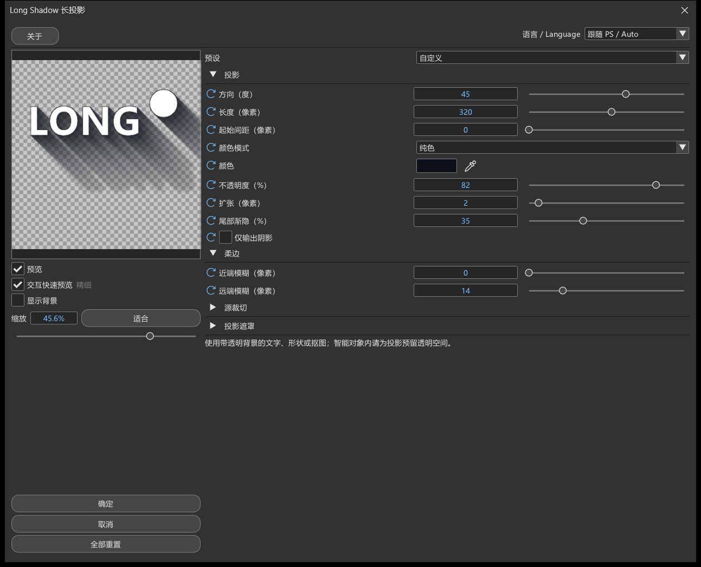

# 0.39 · 31款滤镜、焦散／胶片损伤／长投影

**安装下载：[Windows-x64.zip 插件包](https://github.com/Three-LEI/AE-to-PS-Plugins/releases/download/v0.39/AE-to-PS-Plugins-0.39-Windows-x64.zip)**。source.zip和“Code → Download ZIP”是开发源码，需要自行编译。

这是正式版，设为Latest；保留0.38及更早的正式版本。内部组件编号沿用各自开发编号，整包正式版本以本Release为准。

## 新增三款效果

### Caustics 焦散 0.2

将水面焦散光纹与照片背景折射结合：内置三种水波、当前图层或外部高度图、六套自有预设，光纹强度与图像折射独立调节，提供四种输出。0.2 将新实例的默认背景折射改为 100%，并加入“仅叠加水光”预设；旧实例保留原值。射线并行生成并缓存水波／光纹／折射底图，1024×768、折射 100 的同参数 CPU 中位数约 400.7→160.8 ms，缓存命中调强度约 8.3 ms（不含 Photoshop 读取与显示）。

### Film Damage 胶片损伤 0.5

独立重建静态胶片损伤：颗粒、灰尘、毛发、污渍、断续划痕、色调、暗角、漏光、失焦及固定状态抖动，八套自有预设、53 个保存字段，相同种子与样式变化可稳定复现。0.5 新增“污渍边缘尺寸”，可在不改变污渍主体的情况下获得细密轮廓缺口；0.4 分离污渍边缘粗糙度，0.3 加入污渍纹理。旧参数块自动迁移。

### Long Shadow 长投影 0.3

按 Alpha 为文字、形状或抠图生成定向连续长影：纯色／拉伸源颜色、源色明暗、起始间距、近端／远端模糊、尾部渐隐、扩张、源裁切、矩形／椭圆遮罩及仅阴影输出，五套自有预设。0.3 按每个输出位置的投影距离平滑混合不同模糊半径，修复大范围渐变时阴影内部的弧形接缝。

三款均继承公共快速预览、中英文界面、蓝色单项／全部重置、画布外坐标处理与智能滤镜参数保存，支持 RGB8／16／32。

## 公共修复

- **画布外内容**：普通像素层超出画布时不再报错，也不会丢失或位移画布外内容。读取范围、最终采样写回、生成器源混合与预览统一到文档坐标；选区开启时的 `floatCoord` 归零问题一并修正。27 款重新链接，Tint／Fractal 原生分块二进制保留。
- **完整参考图层**：置换、焦散、玻璃／胶状化等 10 款滤镜按宿主提供的 RGB／Alpha 通道边界读取参考层，保留原文档坐标；画布外波纹可参与画布内计算，置换贴图保留居中、拉伸和平铺设置。

两项修复与效果算法、参数字段和组件身份独立；原有画布内输出保持不变。

## 参数窗口图集

31 款全部提供**实际生产参数窗口**截图，包含精细效果预览和当前参数值：[完整图集](https://github.com/Three-LEI/AE-to-PS-Plugins/blob/main/docs/GALLERY.md)。截图由独立工具复用生产界面与预览代码生成，不打开或修改个人 Photoshop 文档。本Release另附 `screenshots` 压缩包，包含 31 张无损 PNG。

## 验证与边界

- 本机 Windows 11、PS2020 21.2.9：三款新增效果完成 RGB8／16／32、智能滤镜实例、重开／强制重算／撤销／源变化及中英文／DPI 检查；Long Shadow 16 位圆形渐变样例的内部斜率突变由约 0.003418 降至 0.000305。
- 画布外修复：实际 DLL 1456 用例／7,626,774 项检查；PS2020 的 680 个普通效果用例及 536 组“移动→应用→移回”像素对照通过，85 组正常画布内输出与修复前逐像素一致。
- 焦散 0.2：150 组冻结／缓存／直接浮点一致、174 项缓存检查、核心 614,383 与 DLL 6,969,212 项检查；36 个智能实例、54 项像素核对及 18 项独立核心对照通过。
- 胶片损伤 0.5：旧 0.4 PSD 重开／重算 36 项像素对照、新字段 48 项宿主像素检查及 18 项原生输出对照通过。
- 长投影 0.3：旧 0.2 PSD 参数验证与固定半径像素比对通过；0.1 的 18 项普通层、36 个智能实例及 52 项像素检查保持。
- 全部 31 个分发 PE 验证 x64、OS/Subsystem 6.0、`PluginMain` 与传统 PiPL/aete。保留旧 DPI 回退与预编译界面着色器。
- PS2026 27.7.0 本轮仅安装；Win7／CC2018 保留兼容路径，**0.39 仍需外机复测**。

CPU 生成，GPU 用于界面与预览显示。效果是依据公开行为的独立近似实现，不保证与原版逐像素一致；随机纹理不保证同一种子形态相同。ASCII 字形受系统字体影响。部分效果不能自动扩展 Photoshop 画布。Glass／Blobbylize 的外部参考层修改后需重新进入效果确认更新。

## 安装

退出 Photoshop，备份同名插件，把包内 `Plug-ins` 中所需的 `.8bf` 复制到 64 位 Photoshop 的 `Plug-ins` 目录后重启。在 **滤镜 → ZaYu-AE 效果复刻** 中使用；需要反复修改时先转为智能对象。避免多个目录保留重复副本。普通使用无需 AE、原版插件、SDK 或 Python。

自有代码 MIT；演示照片与含照片图集使用独立授权，不随程序包分发。源码包不含 Adobe SDK、字体或个人 PSD。

## English

Stable 0.39 brings the workspace to 31 native Windows x64 Photoshop filters across 24 modules. Three additions: **Caustics** (water caustic light plus underwater refraction, six presets), **Film Damage** (grain, dust, hair, stains, scratches, tone, vignette, light leak and defocus with eight presets) and **Long Shadow** (directional alpha-driven shadows with source crop, masks, soft near/far blur and five presets). All three support RGB8/16/32, Smart Filters, bilingual UI and the shared fast preview.

This release also fixes filters on pixel layers extending beyond the canvas: content is no longer clipped or shifted, and document coordinates are preserved for reads, writes, generator blending and previews. Ten filters now read external reference layers by their channel bounds, including content outside the canvas. In-canvas output is unchanged.

Validation covers Windows 11 with PS2020 21.2.9: RGB8/16/32, Smart Filter instances, reopening, recalculation, undo, source changes and bilingual/DPI checks. PS2026 is installed-only; Win7/CC2018 retains legacy paths and still needs external retesting. Effects are independent approximations, not guaranteed to be pixel-identical to the originals. Install from **Windows-x64.zip**; source archives require compilation. The release also includes a 31-image parameter-window screenshot archive.
